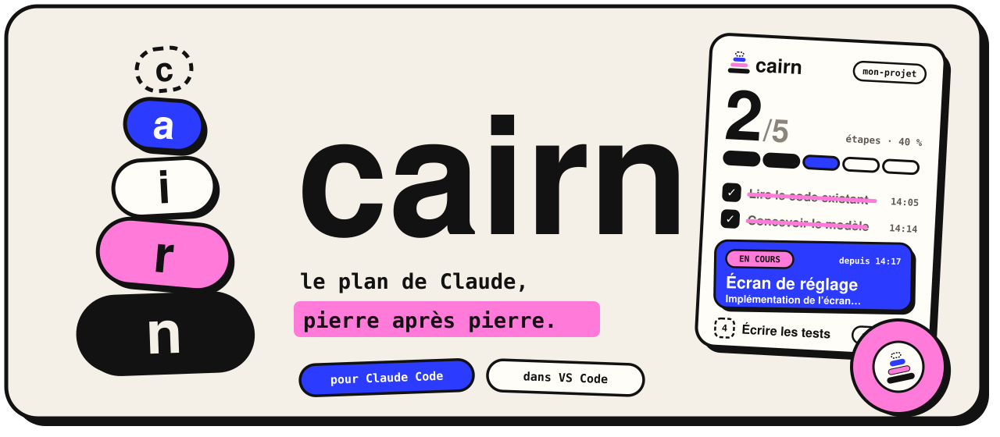
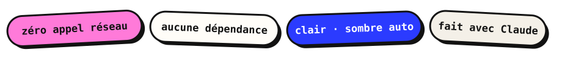
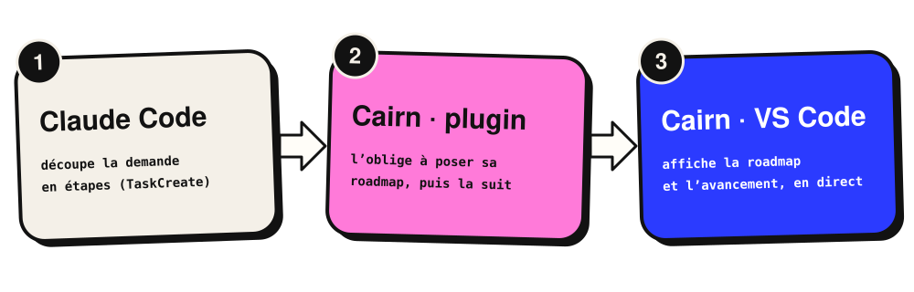

<p align="right"><a href="README.md">English</a> · <b>Français</b></p>

<p align="center">
  
</p>

<p align="center">
  
</p>

<p align="center">
  <b>Sur une grosse demande, Claude Code se fait une liste d’étapes… et la garde pour lui.</b><br>
  Cairn l’oblige à la poser, et l’affiche à côté de ton code comme une vraie roadmap :<br>
  ce qui est fait, ce qui se passe, ce qui reste — et quand c’est à toi de jouer.<br>
  Et tu pilotes depuis là : valider le plan, laisser une note sur une étape, en ajouter ou en retirer une.
</p>

<p align="center">
  
</p>

<table align="center">
  <tr>
    <td align="center"></td>
    <td align="center"></td>
    <td align="center"></td>
    <td align="center"></td>
  </tr>
  <tr>
    <td align="center"><b>Sur le sentier</b><br><sub>où en est Claude, ce que chaque étape a changé</sub></td>
    <td align="center"><b>Claude t’attend</b><br><sub>autocollant, barre d’état, notification</sub></td>
    <td align="center"><b>Piloter</b><br><sub>valider, modifier, annoter le plan</sub></td>
    <td align="center"><b>Historique</b><br><sub>chaque roadmap, gardée et cherchable</sub></td>
  </tr>
</table>

## Comment ça marche

<p align="center">
  
</p>

- **Claude Code** sait découper un travail en étapes (`TaskCreate`, `TaskUpdate`)… quand il y pense.
- **Le plugin Cairn** lui donne la règle au démarrage de chaque session. S’il enchaîne 3 actions qui modifient quelque chose sans roadmap, la 3ᵉ est bloquée une seule fois, le temps qu’il la pose. Il note aussi quand Claude attend une autorisation ou a fini son tour.
- **Ton éditeur** dessine la roadmap de la session lancée dans le dossier ouvert, en direct :

| | |
| --- | --- |
| **Claude t’attend** | Autocollant qui clignote, barre d’état en alerte, notification avec « Ouvrir le terminal ». |
| **Avant / après** | Sous chaque étape, les fichiers touchés. Un clic ouvre la comparaison *avant l’étape ↔ maintenant*. Les fichiers modifiés par une commande (`sed -i`, script…) apparaissent en pointillés. |
| **Le sentier** | Une pierre par étape jusqu’au sommet, « tu es ici » sur l’étape en cours, et le temps restant estimé d’après tes roadmaps passées. Seul ce qui change bouge. |
| **+/− par étape** | Chaque étape montre les lignes qu’elle a changées, quel que soit l’auteur : modifications de Claude, scripts, commandes, sous-agents (dans un dépôt git ; ailleurs seules les modifications de Claude comptent, et une étape qui a pu écrire par une commande montre son heure) ; ouvre-la pour ses fichiers, un clic pour la comparaison *avant l’étape ↔ maintenant*. |
| **Piloter Claude** | Laisse une note sur une étape, retire-en une, ajoutes-en une : Claude le reçoit à sa prochaine action, sans être arrêté. Avec la **validation du plan**, Claude s’arrête après avoir fait son plan ; tu le modifies, tu cliques **Let Claude go**, et il repart aussitôt avec tes changements. |
| **Plusieurs sessions** | Deux Claude dans le même dossier ? Des pastilles pour passer de l’une à l’autre. |
| **Historique** | Chaque roadmap est gardée sur ton poste, même après que Claude Code a vidé sa propre liste : cherche-la, rouvre-la avec le temps et les fichiers de chaque étape, copie-la en Markdown pour une pull request. Une vue large s’ouvre dans un onglet de l’éditeur. |

## Dans ton éditeur

| Éditeur | Comment | Vérifié |
| --- | --- | --- |
| **VS Code** | Extension (barre d’activité « Cairn », historique dans un onglet de l’éditeur) | Oui : installée et utilisée en vrai ; chaque version testée |
| **Cursor, Windsurf, VSCodium** | La même extension (`/cairn:setup` l’installe dans ceux qu’il trouve) | Non : pas encore essayée dans ces éditeurs |
| **VS Code à distance** (SSH, WSL, conteneurs) | L’extension tourne là où tourne Claude Code | Non |
| **JetBrains** (IntelliJ, PyCharm, WebStorm…) | Plugin natif : fenêtre d’outils « Cairn » avec navigateur intégré | Compilé par la CI GitHub ; pas encore lancé dans un IDE |
| **Vim** | `:Cairn` ouvre un panneau latéral mis à jour en direct (pas encore d’historique) | Oui : testé avec Vim 9.1 |
| **Neovim** | Le même plugin (Vimscript) | Non : même code, pas encore essayé |
| **Zed** | Tâche qui ouvre la vue universelle (Zed n’a pas de panneau pour les extensions) | Non |
| **Tous les autres** (Sublime Text, Emacs, Xcode…) | **Vue universelle** dans le navigateur | Oui : testée dans un navigateur |

## Installer

**1 · Le plugin Claude Code**, depuis une copie de ce dépôt :

```bash
claude plugin marketplace add ./cairn
claude plugin install cairn@cairn-local
```

**2 · Le reste, en une commande.** Dans Claude Code :

```
/cairn:setup
```

Elle vérifie que les outils de tâches sont activés (sur les modèles récents, Claude Code ne fournit `TaskCreate` et `TaskUpdate` qu’avec `CLAUDE_CODE_ENABLE_TODO_TOOLS=1`), que la copie du plugin que Claude Code exécute est à jour (il copie les plugins à l’installation), installe l’extension dans VS Code, Cursor, Windsurf ou VSCodium s’ils sont là, et importe dans l’historique les roadmaps encore présentes dans les transcripts de Claude Code. Elle ne change rien sans ton accord. Relance ensuite Claude Code.

<details>
<summary><b>Autres éditeurs</b></summary>

- **Vue universelle** (n’importe quel éditeur) : `node cairn/web/serve.js <dossier du projet> --open` ouvre la roadmap sur `http://127.0.0.1:4823`. Lecture seule, accessible uniquement depuis ton poste ; un clic sur un fichier copie son chemin.
- **JetBrains** : *Settings › Plugins › ⚙ › Install Plugin from Disk…* avec le `cairn-jetbrains-vX.Y.Z.zip` de la release, puis la fenêtre d’outils **Cairn**. Il faut Node.js ; Cairn est cherché dans `~/.claude/plugins/local/cairn` (ou `CAIRN_HOME`).
- **Vim** : `set runtimepath+=~/.claude/plugins/local/cairn/vim` dans le `.vimrc`, puis `:Cairn` Le panneau est en français si `v:lang` l’est (ou avec `let g:cairn_lang = 'fr'`).
- **Neovim** : `vim.opt.runtimepath:append(vim.fn.expand('~/.claude/plugins/local/cairn/vim'))`, puis `:Cairn`.
- **Zed** : copier `zed/tasks.json` dans `~/.config/zed/tasks.json`, puis lancer la tâche « Cairn: Claude's roadmap ».
- **Sans `/cairn:setup`** : `python3 cairn/setup.py` (état des lieux), `python3 cairn/setup.py --fix` (corrige). Le `.vsix` est aussi joint à chaque release.

</details>

## Commandes

| Où | Commande | Effet |
| --- | --- | --- |
| Claude Code | `/cairn:setup` | Vérifie et répare l’installation. |
| Claude Code | `/cairn:pause` · `/cairn:resume` | Coupe puis rétablit le blocage pour la session en cours. |
| Claude Code | `/cairn:go` | Donne le go à un plan qui attend ta relecture, avec les changements laissés dans la vue. |
| VS Code (palette) | « Cairn : Ouvrir la roadmap » · « Ouvrir l’historique » · « Réglages » · « Rafraîchir » (en français si VS Code l’est) | L’historique s’ouvre aussi depuis le bouton ⟲ de la vue. |
| Vim / Neovim | `:Cairn` | Ouvre ou ferme le panneau. |

## Réglages

| Réglage | Par défaut | Effet |
| --- | --- | --- |
| `cairn.accent` · `cairn.pop` (VS Code) | bleu · rose | Couleurs de l’étape en cours et des autocollants. |
| `cairn.staleHours` (VS Code) | `2` | Au-delà, une roadmap est grisée comme ancienne. |
| `cairn.notifications` (VS Code) | activé | Notification quand Claude t’attend. |
| `cairn.language` (VS Code) | `auto` | Anglais ou français, selon VS Code. |
| `CAIRN_THRESHOLD` (environnement de Claude) | `3` | Actions tolérées avant d’exiger la roadmap. |
| `CAIRN_HISTORY_DAYS` (environnement de Claude) | `90` | Durée de conservation des roadmaps passées. |
| `cairn.planGate` (VS Code) · `CAIRN_PLAN_GATE=1` (environnement de Claude) | désactivé | Claude s’arrête après avoir fait son plan, jusqu’à ton go. |
| `CAIRN_GATE_WAIT` (environnement de Claude) | `600` | Secondes pendant lesquelles Claude attend ton go avant de simplement finir son tour (ensuite n’importe quel message, ou `/cairn:go`, le porte). |
| `window.autoDetectColorScheme` (VS Code) | désactivé | Activé, le thème de VS Code, donc celui de Cairn, suit le système. |
| <kbd>Ctrl</kbd>+<kbd>T</kbd> dans Claude Code | — | Replie la liste de tâches du terminal : la roadmap vit dans l’éditeur. |

Désactiver le plugin : `claude plugin disable cairn@cairn-local`.

## Sous le capot

- **Rien ne sort du poste.** Aucun appel réseau, aucune dépendance : Python et Node standard. La vue universelle n’écoute que sur `127.0.0.1` et refuse les requêtes adressées à un autre nom.
- **Le minimum lu.** Les fichiers de tâches de Claude Code ; dans les transcripts, seulement le dossier de lancement, les changements d’étape, les *chemins* des fichiers écrits, le nombre de lignes ajoutées et retirées par chaque modification (compté, jamais gardé) et les références des copies « avant ». Les copies elles-mêmes ne sont lues que pour la comparaison que tu ouvres, en lecture seule.
- **Les instantanés du +/− restent à part.** Dans un dépôt git, à chaque changement d’étape et après chaque action pendant une étape, le hook prend un instantané git des fichiers du projet (`.gitignore` respecté, fichiers de plus de 2 Mo exclus). Les copies des fichiers changés vont dans `~/.claude/cairn/objects/`, lisibles par toi seul et effacées après une semaine sans usage ; ton dépôt n’est jamais modifié. Comme les sauvegardes de Claude Code, elles peuvent contenir un fichier secret que ton `.gitignore` n’exclut pas.
- **Le minimum gardé.** Pour chaque roadmap : les titres d’étapes, statuts, horaires et chemins de fichiers — jamais la conversation. (Les versions 1.4 à 1.5.0 gardaient aussi la première ligne de ta demande ; elle n’est plus affichée et part avec le nettoyage des 90 jours.) Dans `~/.claude/cairn/history/`, lisible par toi seul, effacé au bout de 90 jours ; supprimer le dossier efface tout.
- **Le minimum écrit.** Cet historique, un petit fichier d’état par session dans `~/.claude/cairn/` (« attend », « a fini », « en pause »), tes notes et changements pour Claude dans `~/.claude/cairn/steer/` (lisibles par toi seul), et un compteur dans le dossier temporaire.
- **Le pilotage reste à toi.** Une note arrive à Claude comme contexte, limitée à 500 caractères, nettoyée des caractères de contrôle, et présentée comme venant de toi via Cairn ; les titres d’étapes viennent de la roadmap, jamais de la page. Rien n’est envoyé ailleurs.
- **Vue verrouillée.** Un seul script, le sien, autorisé par jeton ; aucune ressource externe — les polices de marque sont embarquées ; le texte des tâches est échappé ; seuls les fichiers repérés dans le transcript ou par git peuvent être ouverts d’un clic.
- **Accessible.** Avancement et « Claude t’attend » annoncés aux lecteurs d’écran ; focus visible au clavier ; contrastes vérifiés automatiquement ; animations coupées si le système le demande.
- **Sobre.** Relecture toutes les 2 s au premier plan, toutes les 15 s en arrière-plan.
- **Jamais bloquant par erreur.** Si le plugin plante, Claude continue. Dans l’app de bureau Claude, qui a sa propre liste de tâches, il se met en veille.

<details>
<summary><b>Ce que contient le dépôt</b></summary>

```
hooks/        plugin Claude Code : cairn.py, hooks.json
commands/     /cairn:setup, /cairn:pause, /cairn:resume, /cairn:go
setup.py      vérification et réparation de l’installation
vscode/       extension VS Code (et forks) : extension.js, icônes, polices (media/fonts, licences OFL)
web/          vue universelle : serve.js
jetbrains/    plugin JetBrains (Kotlin, construit par la CI)
vim/          plugin Vim / Neovim
zed/          tâche Zed
assets/       logo, tampon et visuels du README (screens.js régénère captures et démo, et y embarque les polices)
check.py      contrôle des hooks sur de faux événements
.github/      tests sur Linux, macOS et Windows à chaque envoi ; release à chaque tag vX.Y.Z
```

</details>

## Tests

```bash
python3 check.py                      # hooks
node vscode/test.js                   # sessions, étapes, avant/après, signaux, rendu, contrastes
node web/test.js                      # vue universelle
vim -Nu NONE -Es -S vim/test.vim      # plugin Vim
python3 setup.py                      # installation (ne modifie rien sans --fix)
node assets/screens.js                # captures et démo du README, depuis le vrai rendu
```

Publier une version : mettre à jour `CHANGELOG.md` et les numéros de version, puis pousser un tag `vX.Y.Z`. GitHub lance les tests, construit le `.vsix` et le plugin JetBrains, et crée la release.

## Limites connues

- Testé en vrai sur macOS avec VS Code. Windows et Linux sont couverts par les tests automatiques, pas encore par un usage réel ; sous Windows, les hooks cherchent `python3` puis `python`.
- Une liste nommée (`CLAUDE_CODE_TASK_LIST_ID`) sans transcript associé n’est pas reliée au dossier ouvert.
- Sur les anciens modèles, où les outils existent sans la variable, le blocage de secours reste inactif.
- La comparaison « avant l’étape » dépend des copies de Claude Code ; sans copie, c’est la comparaison avec git (depuis le dernier commit).
- Les polices embarquées couvrent l’alphabet latin (français compris) ; les autres écritures passent par les polices du système.
- L’historique commence avec la version 1.4 ; `/cairn:setup` récupère ce que les transcripts de Claude Code gardent encore (environ 30 jours). Une roadmap porte le nom de sa première étape.
- La validation du plan attend ton go au plus `CAIRN_GATE_WAIT` secondes (10 min par défaut) ; <kbd>Échap</kbd> dans Claude Code arrête l’attente. Une note arrive à la prochaine action de Claude : une action déjà en cours n’est pas interrompue. On ne peut pas encore réordonner les étapes.

## Crédits

- **Bricolage Grotesque** — © The Bricolage Grotesque Project Authors · **JetBrains Mono** — © The JetBrains Mono Project Authors.
  Toutes deux sous [SIL Open Font License 1.1](https://openfontlicense.org), embarquées dans l’extension et dans les visuels de ce README ; les textes de licence sont dans `vscode/media/fonts/`.

<br>

<p align="center">
  <br>
  <sub>Code écrit avec l’assistance de Claude (IA).</sub>
</p>

<br>

<p align="center">
  <sub>une création</sub><br>
  
</p>
