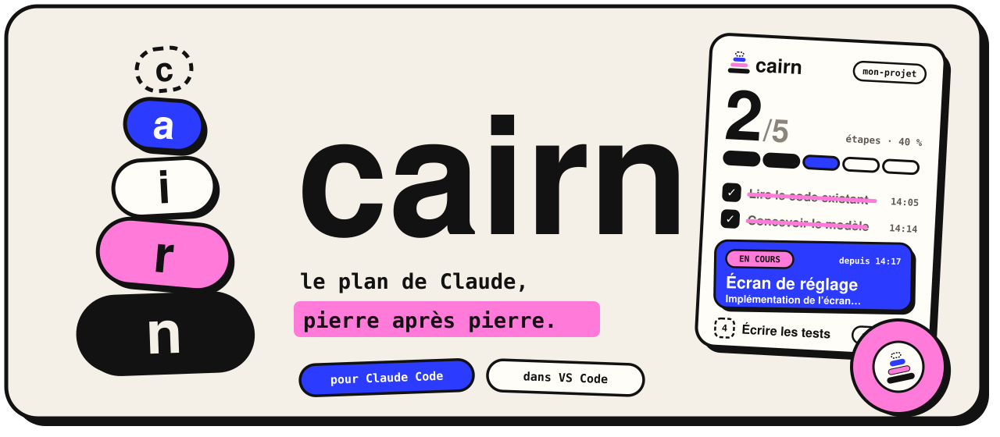

<p align="center">
  
</p>

<p align="center">
  
</p>

<p align="center">
  <b>Sur une grosse demande, Claude Code se fait une liste d’étapes… et la garde pour lui.</b><br>
  Cairn l’oblige à la poser, et l’affiche dans VS Code comme une vraie roadmap :<br>
  ce qui est fait, ce qui se passe, ce qui reste — et quand c’est à toi de jouer.
</p>

<br>

<table align="center">
  <tr>
    <td align="center"></td>
    <td align="center"></td>
    <td align="center"></td>
  </tr>
  <tr>
    <td align="center"><b>En route</b><br><sub>les fichiers touchés sous chaque étape</sub></td>
    <td align="center"><b>Claude t’attend</b><br><sub>autocollant, barre d’état, notification</sub></td>
    <td align="center"><b>Sommet atteint</b><br><sub>le cairn se complète</sub></td>
  </tr>
</table>

## Comment ça marche

<p align="center">
  
</p>

- **Claude Code** sait découper un travail en étapes (`TaskCreate`, `TaskUpdate`)… quand il y pense.
- **Le plugin Cairn** lui donne la règle au démarrage de chaque session. S’il enchaîne 3 actions qui modifient quelque chose sans roadmap, la 3ᵉ est bloquée une seule fois, le temps qu’il la pose. Il note aussi quand Claude attend une autorisation ou a fini son tour.
- **L’extension VS Code** dessine la roadmap de la session lancée dans le dossier ouvert, en direct :

| | |
| --- | --- |
| **Claude t’attend** | Autocollant qui clignote, barre d’état en alerte, notification avec « Ouvrir le terminal ». |
| **Fichiers par étape** | Sous chaque étape, les fichiers écrits pendant qu’elle était en cours. Un clic les ouvre. |
| **Vue vivante** | Seul ce qui change bouge : la nouvelle étape arrive en animation, le chrono avance tout seul. |
| **Plusieurs sessions** | Deux Claude dans le même dossier ? Des pastilles pour passer de l’une à l’autre. |
| **Journal** | Les roadmaps passées du projet ; une roadmap ancienne est grisée et datée. |

## Installer

**1 · Le plugin**, depuis une copie de ce dépôt :

```bash
claude plugin marketplace add ./cairn
claude plugin install cairn@cairn-local
```

**2 · Le reste, en une commande.** Dans Claude Code :

```
/cairn:setup
```

Elle vérifie que les outils de tâches sont activés (sur les modèles récents, Claude Code ne fournit `TaskCreate` et `TaskUpdate` qu’avec `CLAUDE_CODE_ENABLE_TODO_TOOLS=1`), installe l’extension VS Code, et ne change rien sans ton accord. Relance ensuite Claude Code et ouvre l’onglet **Cairn** de VS Code.

<details>
<summary>Sans <code>/cairn:setup</code></summary>

```bash
python3 cairn/setup.py          # état des lieux
python3 cairn/setup.py --fix    # ajoute la variable dans ~/.claude/settings.json et installe l’extension
```

Le paquet de l’extension (`cairn-vX.Y.Z.vsix`) est aussi joint à chaque release du dépôt : `code --install-extension cairn-vX.Y.Z.vsix`.

</details>

## Réglages

| Réglage | Par défaut | Effet |
| --- | --- | --- |
| `cairn.accent` · `cairn.pop` (VS Code) | bleu · rose | Couleurs de l’étape en cours et des autocollants. |
| `cairn.staleHours` (VS Code) | `2` | Au-delà, une roadmap est grisée comme ancienne. |
| `cairn.notifications` (VS Code) | activé | Notification quand Claude t’attend. |
| `cairn.language` (VS Code) | `auto` | Français ou anglais, selon VS Code. |
| `CAIRN_SEUIL` (environnement de Claude) | `3` | Actions tolérées avant d’exiger la roadmap. |
| `window.autoDetectColorScheme` (VS Code) | désactivé | Activé, le thème de VS Code, donc celui de Cairn, suit le système. |
| <kbd>Ctrl</kbd>+<kbd>T</kbd> dans Claude Code | — | Replie la liste de tâches du terminal : la roadmap vit dans VS Code. |

Désactiver le plugin : `claude plugin disable cairn@cairn-local`.

## Sous le capot

- **Rien ne sort du poste.** Aucun appel réseau, aucune dépendance : Python et Node standard.
- **Le minimum lu.** Les fichiers de tâches de Claude Code ; dans les transcripts, seulement le dossier de lancement, les changements d’étape et les *chemins* des fichiers écrits — jamais leur contenu, jamais les messages.
- **Le minimum écrit.** Un petit fichier d’état par session dans `~/.claude/cairn/etat/` (« attend », « a fini »), et un compteur dans le dossier temporaire.
- **Vue verrouillée.** Un seul script, le sien, autorisé par jeton ; aucune ressource externe — les polices de marque sont embarquées dans l’extension ; le texte des tâches est échappé ; seuls les fichiers repérés dans le transcript peuvent être ouverts d’un clic.
- **Jamais bloquant par erreur.** Si le plugin plante, Claude continue. Dans l’app de bureau Claude, qui a sa propre liste de tâches, il se met en veille.

<details>
<summary><b>Ce que contient le dépôt</b></summary>

```
hooks/        plugin Claude Code : cairn.py, hooks.json
commands/     /cairn:setup
setup.py      vérification et réparation de l’installation
vscode/       extension VS Code : extension.js, icônes, polices (media/fonts, licences OFL)
assets/       logo, tampon et visuels du README (screens.js régénère les captures et y embarque les polices)
check.py      contrôle des hooks sur de faux événements
.github/      release automatique à chaque tag vX.Y.Z
```

</details>

## Tests

```bash
python3 check.py           # hooks
node vscode/test.js        # sessions, fichiers par étape, signaux, rendu
python3 setup.py           # installation (ne modifie rien sans --fix)
node assets/screens.js     # captures du README, depuis le vrai rendu
```

Publier une version : mettre à jour `CHANGELOG.md` et les numéros de version, puis pousser un tag `vX.Y.Z`. GitHub lance les tests, construit le `.vsix` et crée la release (`.github/workflows/release.yml`).

## Limites connues

- Testé sur macOS. Sous Windows, la commande `python3` des hooks peut devoir devenir `python`.
- Une liste nommée (`CLAUDE_CODE_TASK_LIST_ID`) sans transcript associé n’est pas reliée au dossier ouvert.
- Sur les anciens modèles, où les outils existent sans la variable, le blocage de secours reste inactif.
- Les polices embarquées couvrent l’alphabet latin (français compris) ; les autres écritures passent par les polices du système.

## Crédits

- **Bricolage Grotesque** — © The Bricolage Grotesque Project Authors · **JetBrains Mono** — © The JetBrains Mono Project Authors.
  Toutes deux sous [SIL Open Font License 1.1](https://openfontlicense.org), embarquées dans l’extension et dans les visuels de ce README ; les textes de licence sont dans `vscode/media/fonts/`.

<br>

<p align="center">
  <br>
  <sub>Code écrit avec l’assistance de Claude (IA).</sub>
</p>
