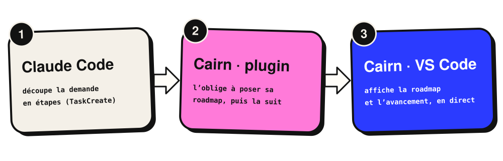

<p align="center">
  
</p>

<p align="center">
  
</p>

<p align="center">
  <b>Sur une grosse demande, Claude Code se fait une liste d’étapes… et la garde pour lui.</b><br>
  Cairn l’oblige à la poser, et l’affiche dans VS Code comme une vraie roadmap :<br>
  ce qui est fait, ce qui se passe, ce qui reste.
</p>

<br>

<table align="center">
  <tr>
    <td align="center"></td>
    <td align="center"></td>
    <td align="center"></td>
  </tr>
  <tr>
    <td align="center"><b>En route</b><br><sub>l’étape en cours, posée de travers</sub></td>
    <td align="center"><b>Thème sombre</b><br><sub>suit celui de VS Code</sub></td>
    <td align="center"><b>Sommet atteint</b><br><sub>le cairn se complète</sub></td>
  </tr>
</table>

## Comment ça marche

<p align="center">
  
</p>

- **Claude Code** sait découper un travail en étapes (`TaskCreate`, `TaskUpdate`)… quand il y pense.
- **Le plugin Cairn** lui donne la règle au démarrage de chaque session. S’il enchaîne 3 actions sans roadmap, la 3ᵉ est bloquée une seule fois, le temps qu’il la pose.
- **L’extension VS Code** lit `~/.claude/tasks/` et dessine la roadmap de la session lancée dans le dossier ouvert, avec l’avancement dans la barre d’état.

## Installer

**1 · Activer les outils de tâches.** Sur les modèles récents (constaté avec Opus 5.5), Claude Code ne fournit `TaskCreate` et `TaskUpdate` qu’avec cette variable, dans `~/.claude/settings.json` :

```json
"env": { "CLAUDE_CODE_ENABLE_TODO_TOOLS": "1" }
```

**2 · Installer le plugin**, depuis une copie de ce dépôt :

```bash
claude plugin marketplace add ./cairn
claude plugin install cairn@cairn-local
```

**3 · Installer l’extension VS Code :**

```bash
code --install-extension cairn/vscode/cairn.vsix
```

Relance Claude Code, ouvre l’onglet **Cairn** dans la barre d’activité de VS Code. C’est tout.

## Réglages

| Réglage | Par défaut | Effet |
| --- | --- | --- |
| `CAIRN_SEUIL` | `3` | Actions tolérées avant d’exiger la roadmap. |
| `CLAUDE_CODE_ENABLE_TODO_TOOLS` | absent | Sans elle, Cairn prévient au démarrage et ne bloque rien. |
| `window.autoDetectColorScheme` (VS Code) | désactivé | Activé, le thème de VS Code, donc celui de Cairn, suit le système. |
| <kbd>Ctrl</kbd>+<kbd>T</kbd> dans Claude Code | — | Replie la liste de tâches du terminal : la roadmap vit dans VS Code. |

Désactiver le plugin : `claude plugin disable cairn@cairn-local`.

## Sous le capot

- **Rien ne sort du poste.** Aucun appel réseau, aucune dépendance : Python et Node standard.
- **Lecture seule.** Les fichiers de tâches de Claude Code ; dans les transcripts, uniquement le dossier de lancement de la session.
- **Vue verrouillée.** La roadmap n’exécute aucun script (politique de sécurité « tout interdit ») et le texte des tâches est échappé.
- **Discret.** Dans l’app de bureau Claude, qui a sa propre liste de tâches, le plugin se met en veille.

<details>
<summary><b>Ce que contient le dépôt</b></summary>

```
hooks/      plugin Claude Code : cairn.py, hooks.json
vscode/     extension VS Code : extension.js, cairn.vsix, icônes
assets/     logo, tampon et visuels du README (screens.js régénère les captures)
check.py    contrôle des hooks sur de faux événements
```

</details>

## Tests

```bash
python3 check.py           # hooks
node vscode/test.js        # lecture des tâches et rendu de la roadmap
node assets/screens.js     # captures du README, depuis le vrai rendu
```

Reconstruire l’extension : `cd vscode && npx @vscode/vsce package --no-dependencies --allow-missing-repository --skip-license -o cairn.vsix`.

## Limites connues

- Testé sur macOS. Sous Windows, la commande `python3` des hooks peut devoir devenir `python`.
- Une liste nommée (`CLAUDE_CODE_TASK_LIST_ID`) sans transcript associé n’est pas reliée au dossier ouvert.
- Sur les anciens modèles, où les outils existent sans la variable, le blocage de secours reste inactif.
- Les polices de marque (Bricolage Grotesque, JetBrains Mono) ne sont pas embarquées : la vue prend celles du système et de l’éditeur.

<br>

<p align="center">
  <br>
  <sub>Code écrit avec l’assistance de Claude (IA).</sub>
</p>
